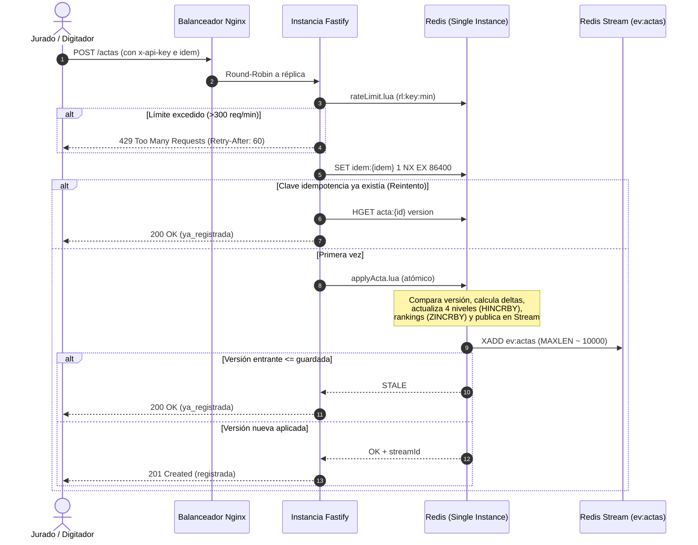
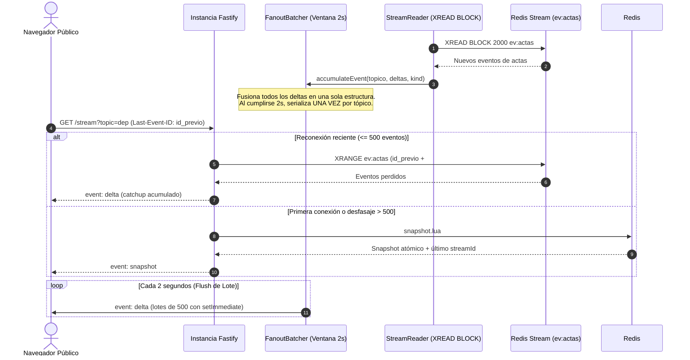
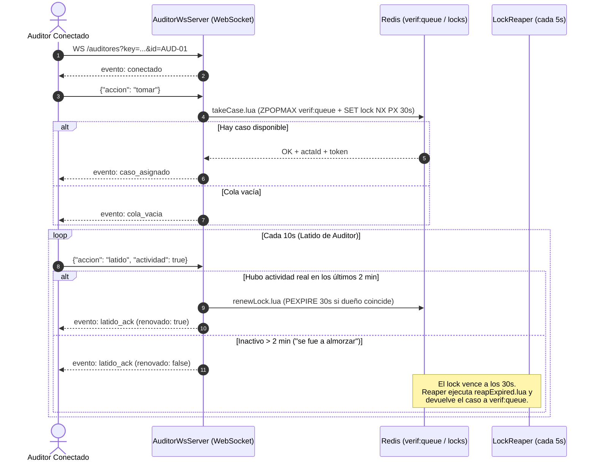
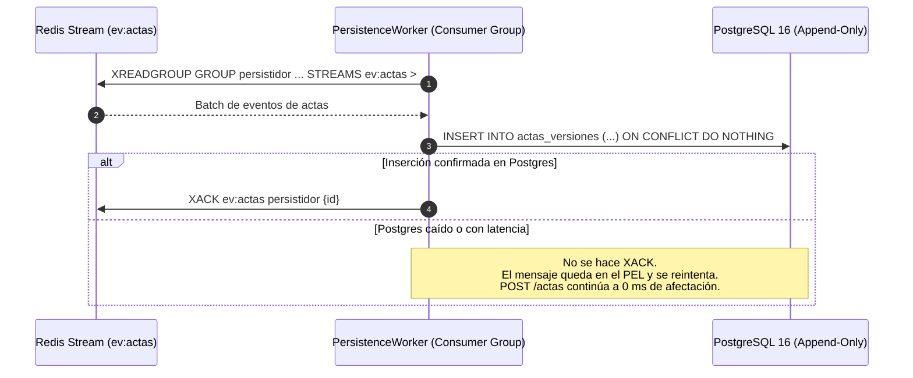

# Diagramas de Secuencia y Arquitectura

---

## 1. Ingestión de Actas (Jurados)

---

## 2. Difusión y Streaming Masivo (Público)

---

## 3. Consola de Verificación y Semáforo Distribuido (Auditores)

---

## 4. Persistencia Desacoplada a PostgreSQL (Append-Only)

